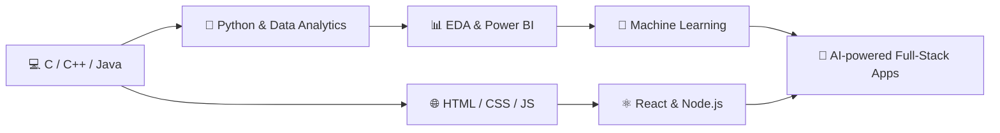

<div align="center">


<a href="https://github.com/snehashis1620">

</a>

<br/>


<br/><br/>

<a href="https://www.linkedin.com/in/snehashis-aich-341612352/"></a>
<a href="mailto:snehashisaich7@gmail.com"></a>
<a href="https://www.behance.net/snehashisaich"></a>
<a href="https://medium.com/@snehashisaich7"></a>

</div>

---

## 👋 About Me


Hi there, I'm **Snehashis** 👋

```yaml
name:       Snehashis Aich
education:  B.Tech CSE (Artificial Intelligence) @ GIFT Autonomous, Bhubaneswar
interests:  Full-Stack Development · Data Analytics · Machine Learning
exploring:  Python · ML · data-driven problem solving
experience: Data Analytics with Python (internship) · Smart India Hackathon 2024
coursework: Design & Analysis of Algorithms · Digital Signal Processing
```

---

## 🛠️ Tech Stack

### 💻 Languages
<p>
  
</p>

### 🌐 Web & Full-Stack
<p>
  
</p>

### 🗄️ Databases
<p>
  
  
</p>

### 📊 Data Science, AI & ML
<p>
  
  
  
  
  
</p>

### ☁️ Cloud, Tools & Testing
<p>
  
  
  
</p>

### 🎨 Design & Creative
<p>
  
  
</p>

---

## 🚀 Featured Projects

<table>
<tr>
<td width="50%" valign="top">

### 🏥 MediQueue
**Healthcare Appointment Management System**
*Built for Smart India Hackathon 2024* 🏆

A web platform that simplifies how patients book and manage healthcare appointments, reducing queues and manual scheduling.


[](https://github.com/snehashis1620/MediQueue)

</td>
<td width="50%" valign="top">

### 📈 Student Performance Analytics
**End-to-end data pipeline with an interactive dashboard**

Data cleaning, EDA, a Logistic Regression model and a Power BI dashboard to understand and predict student outcomes.


[](https://github.com/snehashis1620/Student-Performance-Analytics)

</td>
</tr>
</table>

<details>
<summary><b>🔎 Click to expand: Student Performance Analytics pipeline</b></summary>

<br/>

| Stage | What I did |
|:--|:--|
| 🧹 **Data Cleaning** | Handled missing values, fixed data types, encoded categorical features |
| 📊 **EDA** | Distributions, correlations and group comparisons |
| 🤖 **Modeling** | Logistic Regression to predict student outcomes |
| 📐 **Evaluation** | Accuracy, precision, recall, F1-score, confusion matrix |
| 📺 **Dashboard** | Interactive Power BI report for non-technical viewers |

</details>

---

## 🧭 My Learning Path



---

## 🏅 Achievements

<p align="center">
  
  
  
</p>

---

## 📊 GitHub Stats

<div align="center">


<br/><br/>


<br/><br/>

### 📅 Contribution Graph


<br/><br/>

### 🐍 Contribution Snake


</div>

---

## 🎯 Currently Working Towards

- [x] Data Analytics with Python internship
- [x] Smart India Hackathon 2024 (MediQueue)
- [ ] Deepening Machine Learning & AI skills 🤖
- [ ] Building full-stack projects with React & Node.js 🌐
- [ ] Contributing to open source 🌍

---

## ⚡ Fun Facts

<div align="center">

| 🔭 Building | 🌱 Learning | 💬 Ask me about | ⚡ Fun fact |
|:--:|:--:|:--:|:--:|
| MediQueue & data dashboards | ML, React, Node.js | Python, Data Analytics | I design too: Figma, Photoshop & Blender |

</div>

> 💡 *"Data is the new oil, but only if you can refine it."*

---

## 🌐 More Places to Find Me

<div align="center">

[](https://stackoverflow.com/users/33076728/snehashis-aich)
[](https://codepen.io/Snehashis-Aich)
[](https://www.youtube.com/@SnehashisAich-T16)
[](https://x.com/snehashis16t)
[](https://bsky.app/profile/snehashis16.bsky.social)
[](https://mastodon.social/@Snehashis16)
[](https://www.reddit.com/user/RealStatistician2192/)
[](https://www.quora.com/profile/Snehashis-Aich-1)
[](https://www.instagram.com/its_sneha_2120/)
[](https://www.facebook.com/profile.php?id=100069827414789)
[](https://in.pinterest.com/snehashisaich7/)

<br/>

📫 **Open to internships, collaborations and exciting projects**

<br/>

<a href="https://visitcount.itsvg.in"></a>


</div>
